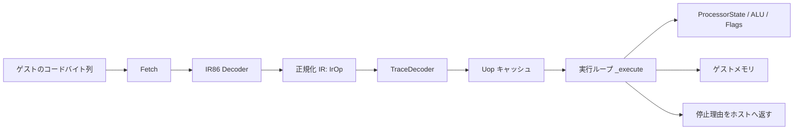

# PLUM / IR86 設計

現在の実装の構成、実行モデル、ホストとの境界、制約をまとめる。テストは [TESTING.md](TESTING.md)、最適化の判断は [PERFORMANCE.md](PERFORMANCE.md) を参照する。

## 1. 目的と範囲

PLUM は x86 コードを実行する Rust ライブラリで、IR86 はその基盤となる独立した命令デコーダーである。実行エンジンは 2 種類ある。

| エンジン | 対象 | メモリ |
| --- | --- | --- |
| `harvard::HarvardUME` | ユーザーモードのコード | コードとデータを別の領域に置く |
| `flat::FlatUME` | ユーザーモードのコード | コード・データ・スタックが 1 つの領域を共有し、コードの書き換えを検知する |

HarvardUME と FlatUME はユーザーモードエミュレーター（UME）であり、OS や PC 全体は再現しない。実行形式のロードと OS サービスはホストの責務である。

- IR86 は 16 / 32 ビットのデコードモードを持つ。HarvardUME と FlatUME のトレース生成は常に 32 ビットモードから始まる。
- x86-64 と AVX は実行できない。
- x87 は `x87` feature で、MMX / SSE / SSE2 は `sse` feature で実行する。どちらも既定で有効で、`sse` は `x87` を含む。

## 2. リポジトリ構成

| 構成 | 役割 |
| --- | --- |
| `ir86` | 命令バイト列から正規化された IR を生成する。定義元は [ir.csv](../ir86/src/ir.csv) と [simd.csv](../ir86/src/simd.csv) |
| `plum` | CPU 状態、ALU、トレース生成、2 種類の実行エンジン |
| `tools/disasm` | 逆アセンブルと命令統計の CLI |
| `lib/elf`、`lib/hrb` | ELF ヘッダー、Haribote OS の HRB ヘッダー |
| `fixtures` | 固定のゲストバイナリ（hex テキスト）と hash |
| `scripts` | テストとベンチマークの補助スクリプト（[scripts/README.md](../scripts/README.md)） |

- workspace のメンバーは `ir86`、`plum`、`tools/disasm`。
- `disasm` は TEK 展開に Git 依存の `tek` を使う。
- `ir86` と `plum` は `no_std` と `alloc` を使う。ヒープは必要だが、標準入出力やホスト OS の API には依存しない。
- Rust edition は 2024、[rust-toolchain.toml](../rust-toolchain.toml) は `nightly`。
- 依存の方向は `plum → ir86`。

## 3. 命令処理の流れ



- IR86 と PLUM の間は `IrOp` でつなぐ。IR86 は命令の意味とオペランドを表し、PLUM はそれを実行しやすい `Uop` に変換する。
- ネイティブコードを生成する JIT ではない。キャッシュした Uop を `match` で実行するインタープリターである。

### 3.1 バイト取得と IR

- `Fetch` は `fetch_u8()` と `current_eip()` を要求する。16 / 32 ビット値はリトルエンディアンで読む。取得失敗は取得側のエラー型として `Decoder::decode()` から返る。
- `SimpleFetcher` はスライスと現在位置を持ち、位置をそのまま EIP にする。ベースアドレスが必要なら、EIP にベースを加える `OffsetFetcher` で包む。
- `Decoder` はオペランド幅、アドレス幅、セグメント上書き、LOCK / REP プレフィックス、ModR/M、SIB、変位、即値を解釈する。相対分岐の宛先は fetcher の現在 EIP から計算する。
- IR は命令形式を正規化するので、元のエンコーディングの完全な再現には向かない。デコードできる命令と PLUM で実行できる命令は一致しない。
- [build.rs](../ir86/build.rs) は CSV から `IrOp` などを含む `src/_generated/` を生成する。生成先は `OUT_DIR` ではなくソースツリー内で、命令定義の変更は CSV と生成処理から始める。
- x86 の命令長の上限（15 バイト）を超える命令について、実機と同じ例外を返すことの優先度は低い。トレーサーは終わりのないプレフィックスの並びでも止まるよう、長さを打ち切る。

### 3.2 マイクロ命令への変換

- 各エンジンの `tracer.rs` は、IR をレジスター演算、アドレス計算、ロード、ストア、分岐などの Uop に分解する。たとえばメモリ演算は、実効アドレスを求め、値を一時レジスターへ読み、ALU で演算して書き戻す。頻出の形には専用の RMW Uop や融合 Uop がある。
- `MemAddr` と `MemData` は変換用の内部レジスター。複数の Uop にまたがる命令は、この 2 つだけで値を受け渡す。単純なベースアドレスでは既存のレジスターを直接使う。
- 各エンジンの `uop.rs` の `Uop` は、主 dispatcher に置く命令と、`Uop::Minor(UopMinor)` にまとめる低頻度の命令に分かれる。
  - コンパイル時に `size_of::<Uop>() <= 8` を検査する。
  - 配置の方針は [PERFORMANCE.md](PERFORMANCE.md) にある。

## 4. トレースと制御フロー

`TraceDecoder` は次の情報を持つ。

| 情報 | 型・用途 |
| --- | --- |
| 実行位置 | `current_upc: AddrIndex`。Uop キャッシュのインデックス |
| 命令キャッシュ | `Vec<Uop>`。変換済みの Uop |
| アドレス対応 | `BTreeMap<Offset32, AddrIndex>`。ゲスト命令アドレスから Uop の先頭へ |
| 関数対応 | 関数のベクターと `BTreeMap<Offset32, FuncIndex>`。直接 CALL の宛先 |
| RET 宛先キャッシュ | 16 要素の固定配列。実際の戻り先 EIP と UPC |

- HarvardUME は、初期化時に最大 1 命令、通常の追加デコードでは最大 1024 命令をまとめて変換する。コード末尾に続くゼロバイトはフェッチ対象から除く。
- FlatUME は 1 回に 1 命令だけを変換し、データかもしれない後続のバイトを先読みしない。
- 変換済みの命令アドレスへ到達したら、対応する UPC への `Jump` でつなぐ。`FetchNext` は遅延デコードの継続点で、継続部分を生成するときに命令を配置するか、新しい領域への `Jump` に置き換える。
- 未解決の条件分岐は `JccU` として持ち、成立したときに宛先を解決してキャッシュを書き換える。ZF だけを使う条件は `Jz` / `Jnz` に特殊化する。間接分岐は実行時のレジスター値を EIP として解決する。
- CALL はゲストスタックへ戻り先を積む。RET はスタックから読んだ値を宛先にし、呼び出し履歴から推測しない。
  - RET キャッシュは EIP の下位 4 ビットでスロットを選び、EIP タグの一致でヒットとする。ミス時は通常のアドレス解決に戻る。
- HarvardUME のキャッシュは、コードが不変で既存の UPC が実行可能であり続けることを前提とする。無効化 API、トレースの上限、退避方式はなく、到達したコードに応じてキャッシュが増える。
- FlatUME はコードの書き換えを検知してキャッシュを捨てる（6.2 節）。

## 5. CPU 状態とフラグ

### 5.1 レジスター

- `ProcessorState` は汎用・内部レジスターの 16 要素配列、6 個のセグメントレジスター、フラグ、遅延演算情報、CPU 世代、x87 / SIMD 状態を持つ。
  - 全ビルドで `repr(C)` とし、汎用レジスター配列をオフセット 0 に固定する（理由は [PERFORMANCE.md](PERFORMANCE.md)）。
- `RtReg` は EAX〜EDI、EIP、`MemAddr`、`MemData`、`Zero` などを識別する。
- [gpr.rs](../plum/src/gpr.rs) は 32 ビット値に対し、16 ビットと上下の 8 ビット部分へのビューを提供する。部分レジスターへの書き込みは他のビットを保持する。
- CPU 世代は I386〜NetBurst の列挙で、UME の初期化では `Generation::LATEST`（P6）を選ぶ。フラグの固定ビットや CPUID の構成に使うが、各世代の CPU 全体を再現するものではない。

### 5.2 遅延フラグ

- [alu.rs](../plum/src/alu.rs) の演算は、必要に応じて入力を `LazyOp` に残す。
- [flags.rs](../plum/src/flags.rs) の `FlagsRegister` は値と `valid_mask` を持ち、未計算の CF / PF / AF / SF / OF を [lazy.rs](../plum/src/flags/lazy.rs) で求める。ZF は演算結果から即時に更新する。
- 条件分岐は必要なフラグだけを解決する。INC / DEC は CF を保持し、ADC / SBB は入力キャリーを記録する。CF だけを更新する命令などでは、古い遅延演算との依存を解いてから部分更新する。
- ホストへ停止を返すときは `resolve_flags()` で値を確定する。通常の実行中に `state().flags()` を直接読むと、算術フラグがすべて確定しているとは限らない。

## 6. 実行エンジン

### 6.1 HarvardUME

```rust
use plum::prelude::*;

let code = vec![0xcd, 0x40].into_boxed_slice(); // INT 0x40
let data = vec![0; 4096].into_boxed_slice();
let mut cpu = plum::ume::harvard(
    code,
    data,
    Offset32(0),    // entry
    Offset32(4096), // 初期 ESP
);
assert!(matches!(cpu.execute(), Err(Exception::Swi(0x40))));
```

- **領域：** コードとデータは別の領域で、スタックはデータ領域内に置く。
  - CS 指定の読み込みはコードを、その他のセグメントはデータを参照する。
  - 実行時のセグメント値によるセグメント変換や、アクセス権の検査は行わない。
- **アドレス：** データアドレスはデータスライスのインデックス。コードのベースは内部で 0 に固定される。エントリー EIP、命令フェッチ、分岐先、戻り先、CS 経由の読み込みは、コードスライスのインデックスを使う。
- **境界検査：** 8 / 16 / 32 ビットの読み書きはスライス境界を検査する。範囲外は `SegmentationViolation`、スタック操作の失敗は `StackFault` になる。CS への書き込みは拒否する。
- **`data()`：** `&self` から可変スライスを返す。実行と外部アクセスを単一スレッドで直列に扱い、同じ領域への参照が重ならないようにする必要がある。
- **`to_semi_flat()`：** HarvardUME を FlatUME へ変換する。

### 6.2 FlatUME

```rust
use plum::prelude::*;

let mut memory = vec![0; 8192];
memory[..9].copy_from_slice(&[0xb8, 1, 0, 0, 0, 0xcd, 0x40, 0xeb, 0xf7]);
let mut cpu = plum::ume::flat(
    memory,
    Offset32(0),    // guest_base
    Offset32(0),    // entry
    Offset32(8192), // 初期 ESP
)
.unwrap();
assert!(matches!(cpu.execute(), Err(Exception::Swi(0x40))));
cpu.write_memory32(1, 2).unwrap(); // キャッシュ済みの MOV の即値を書き換える
cpu.resume_next(); // INT の次へ進み、JMP から再実行する
assert!(matches!(cpu.execute(), Err(Exception::Swi(0x40))));
```

**アドレスとセグメント**
- 有効なゲストアドレスは `[guest_base, guest_base + memory.len())` で、32 ビットのアドレス空間内に収める。エントリーがこの範囲の外なら `InitError` を返す。
- IR は元の segment override と既定の segment を保持する。FlatUME の lowering とメモリアクセスは、CS / DS / ES / SS / FS / GS を同じ領域への線形アドレスとして扱う。CS 専用のロードや CS 書き込みの拒否はない。
- FS / GS は、ホストが設定した GS の base を使う GS 相対 `disp32` のロードと、間接 CALL にだけ対応する。そのほかの FS / GS 上書きは `TodoKind::SegmentOverride` で、MOV Sreg のメモリ形式と PUSH/POP Sreg は `TodoKind::SegmentMemory` で止まる。MOV Sreg, r/m は `Exception::LoadSegment` でホストに検査を委ねる。

**ホストからのアクセス**
- メモリの変更は `write_bytes` / `write_memory8` / `write_memory16` / `write_memory32` を通す。追跡を迂回する可変スライスは公開しない。
- `memory()` は読み取り用のスライスを返す。
- `execute()` を再び呼ぶと、停止した命令を再試行する。`resume_next()` を呼んでから実行すると、停止時に保存した次の命令へ進む。ホストが停止命令の長さを変えても、保存した境界を使う。

**コード書き換えの検知**
- 監視の単位は領域先頭からの 4 KiB ページ。デコード済みのページへ書き込みがあると、実行中の x86 命令を完了させてから、次の命令の前に全キャッシュを捨てる。
- 解決済みの分岐・CALL・RET の参照も捨て、古い UPC や FuncIndex を再利用しない。
- 命令のバイトが変わらなくても、同じページへの store（同じ値の store を含む）は保守的に検知する。
- 通常の store、RMW、スタック、REP、x87、SIMD、ホスト API が検知に接続している。
- 部分的な無効化、ページ権限、複数のメモリ領域はない。
- x87 は元の segment を FDP の selector に記録するが、メモリアクセスに segment base は加えない。

**Linux/i386 の利用例**
- [plum/examples/linux32](../plum/examples/linux32/README.md) は静的 ELF ローダーと read / write / mmap2 / exit の最小 ABI を持つ。JIT 計算機でコード更新を確認する。

### 6.3 共通インターフェース

- UME は `plum::ume::harvard()` / `plum::ume::flat()` で生成する。`HarvardUME::new` / `FlatUME::new` は crate 外に公開しない。`flat()` は `Result<FlatUME, InitError>` を返す。
- `plum::ume::Emulator` トレイトは HarvardUME と FlatUME の共通操作を定める。
  - `state` / `state_mut`、`execute`、`resume_next`、`memory`、`brk`、`write_memory`、`fill_memory`、`read_memory`、`get_cstring` など。
  - FlatUME の `brk` は拡張だけに対応し、新しいバイトをゼロで初期化する。
- 停止理由の `plum::ume::Exception` も 2 つの UME で共有する（10 節）。
- `plum::prelude` は IR86 の型、`cpu`、`flags`、`types`、`ume` を再エクスポートする。

## 7. エンジン間の共通実装

2 種類のエンジンは独立した実行エンジンを保つ。共有するのは CPU 状態、ALU、フラグ、デコーダーと、次の計算部分だけである。共通の主 dispatcher、エンジントレイト、メモリトレイトは設けない。

| 共通実装 | 責務 | 各エンジン側に残す責務 |
| --- | --- | --- |
| `src/string_ops.rs` | 検証済みの span / range、要素の読み込み、比較、重なりを考慮したコピー、パターン充填 | 命令属性、ゲストアドレスと領域オフセットの変換、範囲検査の順序、進捗とフラグの確定、書き込み通知 |
| `src/fpu/ops.rs` | approx64 バックエンドの算術と平方根 | オペランドの取得、命令成功時の記録 |
| `src/fpu/codec.rs` | 形式の幅、バイト列の変換、FOP の解析 | 範囲検査、書き込み、FOP を読む時機 |
| `src/fpu/register_ops.rs` | `ProcessorState` だけで完結する x87 レジスター命令と比較 | 各エンジンの Uop / 例外への変換、FIP / FDP / FOP の更新 |
| `src/simd/` | MMX / SSE / SSE2 の状態と演算 | 例外クラスの検査、メモリオペランドの取得 |
| `src/alu/division.rs` | DIV / IDIV の検査と商・余り | 被除数の読み取り、例外の変換、成功時のレジスター更新 |
| `src/profile_support.rs` | EIP ごとの集計、TSV の整形 | ゲストのエントリー検索、再試行の扱い、内部 Uop の除外 |

- `HarvardUME` / `FlatUME`、`TraceDecoder`、主 `Uop`、キャッシュ構造、主実行ループは各エンジンが持つ。通常の load/store、スタック、RMW、分岐、停止と再開は共有しない。
- `string_ops` は正の検証済み span を前提とする。ECX=0 はアダプターが処理し、メモリアクセスも書き込み通知もしない。
- 数値 codec とレジスターの副 dispatcher はインライン指定にし、共有による呼び出し境界を増やさない。除算も同じ。
- profile は `uop-profile` feature が無効ならモジュールごとコンパイルしない。
- 数行の重複（`set_szp8`、bit 操作、SIB の wrapper など）は、主 dispatcher や CPU の責務を広げてまでなくさない。

**命令を追加するときの更新箇所**
- REP の新しい処理は、各 `uop.rs` / `tracer.rs` とアダプターに追加する。純粋なバイト操作があれば `string_ops` に追加する。
- x87 のレジスター命令は共通の `fpu/uop.rs` と `register_ops` を、メモリ命令は各エンジンの `fpu.rs` と codec を更新する。
- lowering は各エンジンでそれぞれ更新する。

## 8. 文字列命令とビット操作

### 8.1 文字列命令

- 各エンジンの `string.rs` は、MOVS / STOS / LODS / CMPS / SCAS の byte / word / dword、DF による方向、REP 系の反復を扱う。
  - `StringOp` は種類、幅、反復、セグメント、アドレス幅を 16 ビットに格納する。
  - アドレスと反復回数はキャッシュせず、実行時の ESI / EDI / ECX から取得する。
- 幅と方向を一度選び、境界内で処理できる連続範囲をまとめて実行する。
  - MOVS は重なりと方向を考慮する。一括コピーで逐次命令の意味を保てない場合は、要素単位で処理する。
  - STOS はパターン充填、LODS は処理範囲の最後の要素を累積レジスターへ反映する。
- CMPS / SCAS は REP 条件で止まる要素を探し、最後の比較を ALU に反映する。完了した範囲ごとに ESI / EDI / ECX を更新するので、境界違反の後も完了済みの進捗は残る。
- HarvardUME では、16 ビットアドレスの文字列命令が `Unimplemented` で止まる。ユーザーモードのポート I/O は REP 回数がゼロでも拒否する。

### 8.2 ビット操作

- BT / BTS / BTR / BTC は `BitAction` で共通化し、元の選択ビットを CF に反映する。
- レジスター宛先のインデックスは幅でマスクする。メモリ宛先では、レジスターのインデックスが隣の word / dword にまたがるので、実効アドレスも調整する。即値のインデックスは同じ要素内に収める。
- 入力は部分レジスターへの書き込み前に取得し、宛先とインデックスの別名参照を扱う。

## 9. x87 と SIMD

### 9.1 x87

x87 は `approx64` バックエンドで実行する。厳密な 80 ビット演算（soft80）ではない。

- 正規の m80、ゼロ、無限大、NaN、非正規化数は生の 80 ビット値のまま転送する。演算を挟まない往復では元の値を保持する。FILD / FISTP m64int は全 64 ビットを保持する。
- 四則演算と平方根は、丸めが nearest で PC=53/64 なら f64 で近似する。PC=24 か nearest 以外なら、整数の仮数で計算して PC / RC を適用する。
- 比較は値を 80 ビットへ正確に拡張して行う。整数変換と FRNDINT は 4 方向の丸めを整数のビット操作で扱う。
- 三角関数、指数・対数、剰余、BCD も実装している。超越関数は近似。
- 基本算術の例外フラグ（PE / UE / C1 など）の完全一致は保証しない。
- HarvardUME と FlatUME は数値例外をアンマスクする変更（FLDCW など）を拒否する。
- `x87` feature が無効のときは、FPU 状態も dispatcher も `libm` も含めない。
- 命令の分類（opcode / ModRM からの判定）は PLUM 側で行っている。IR86 へ移す案は [future/ir86-x87-decode-plan.md](future/ir86-x87-decode-plan.md)。

### 9.2 MMX / SSE / SSE2

- IR86 は feature に関係なく、MMX / SSE / SSE2 の全形式をデコードする。実行するかどうかはエンジンが決める。`sse` が無効なら全形式が `#UD`（`Exception::InvalidOpcode`）になる。
- `sse` が有効なら、CPUID leaf 1 は MMX、FXSR、SSE、SSE2、CLFSH と 64 バイトの CLFLUSH ラインサイズを報告する。
- **必須プレフィックスの選び方**（`ir86/src/simd.rs` の `SimdPrefix`）：
  - REP プレフィックスが F2 / F3 ならそれを使う。両方あれば後に出たほう。どちらもなければ、66 の有無で選ぶ。
  - F2 / F3 が選ばれたとき、66 はオペランドサイズのプレフィックスとして残る。
  - GPR を使う形式（MOVD、CVTSI2SD、PEXTRW など）は、モードに関係なく r/m32 に固定する。これは SDM の保証ではなく、Intel 実機と主要なデコーダーの事実上の動作である。
- **例外クラス**（`ir86::SimdClass`）。形式ごとに見る状態が違う。

  | クラス | 対象 | CR0.EM=1 | CR0.TS=1 | CR4.OSFXSR=0 | 未処理の x87 例外 |
  | --- | --- | --- | --- | --- | --- |
  | `Xmm` | XMM を使う SSE / SSE2（LDMXCSR / STMXCSR を含む） | `#UD` | `#NM` | `#UD` | 見ない |
  | `MmXmm` | MM と XMM の間の転送・変換 | `#UD` | `#NM` | `#UD` | `#MF` |
  | `Mm` | MMX と、SSE / SSE2 が追加した MM 形式 | `#UD` | `#NM` | 見ない | `#MF` |
  | `FxState` | FXSAVE / FXRSTOR | `#NM` | `#NM` | 見ない | 見ない |
  | `NoCheck` | CLFLUSH、フェンス、MOVNTI | 見ない | 見ない | 見ない | 見ない |

- **浮動小数点の結果：** すべての丸めモードと FTZ / DAZ で、結果と MXCSR のフラグが x86 とビット単位で一致する。RCP / RSQRT は誤差範囲内の近似。
  - 既定の経路では、nearest かつ FTZ / DAZ がオフで、入力と結果が正規化数かゼロのときにホストの f32 / f64 を使う。それ以外はソフトウェア実装に回る（[simd/float.rs](../plum/src/simd/float.rs)）。
- **整数・論理演算：** 固定長配列で書き、ホストの SIMD 命令への自動ベクトル化に任せる（[simd/lanes.rs](../plum/src/simd/lanes.rs)）。
- **HarvardUME と FlatUME の前提状態：** CR0.EM=0、CR0.TS=0、CR4.OSFXSR=1、CR4.OSXMMEXCPT=1 として動く。
  - 16 バイト境界に合わないオペランドと MXCSR の予約ビットは `Exception::GeneralProtection`。
  - 数値例外をアンマスクする LDMXCSR / FXRSTOR は `Unimplemented` で拒否するので、`#XM` は起きない。
  - 16 ビットアドレスのメモリオペランドは `TodoKind::SimdAddress16` で止まる。

## 10. 実行停止とホスト連携

`execute()` は Uop を連続して実行し、停止したら `Result<(), Exception>` を返す。命令数によるタイムスライスはなく、無限ループのゲストは戻らない。

| `Exception` | 意味 |
| --- | --- |
| `DivisionError` | 除算エラー |
| `Unimplemented(Uop)` / `Unimplemented2(Uop)` | 意図的に止めた有効な命令（HarvardUME / FlatUME の Uop） |
| `StackFault` | スタックアクセスの失敗 |
| `SegmentationViolation(Offset32)` | メモリ境界の違反や禁止されたコード書き込み |
| `OutOfCode` | 実行する Uop を取得できない |
| `RdTsc` | 時刻値の供給をホストに委ねる |
| `Swi(u8)` | ソフトウェア割り込み |
| `SysEnter` / `SysCall` | SYSENTER / SYSCALL をホストに通知する |
| `LoadSegment(SrIndex, u16)` | MOV Sreg, r/m。ホストが selector を検査して `sr` を更新し、再開する |
| `InvalidOpcode` | `#UD`。CPU が定義していないエンコーディング |
| `GeneralProtection` | 実装済みの命令の `#GP(0)`（非整列の 16 バイト SSE オペランド、MXCSR の予約ビットなど） |

- 停止を返す前に、`adjust_after_exception()` が現在の UPC を EIP に反映し、遅延フラグを確定する。EIP の復元はアドレスマップの走査で、最悪 O(n)。通常の実行中は UPC で進み、状態内の EIP は毎命令は更新しない。
- ホストは SWI などを受けてレジスターやメモリを更新できる。停止命令を処理済みとして先へ進むなら、`resume_next()` を呼んでから `execute()` を再開する。フォールトした命令を再実行するなら、その命令を飛ばさない。
- 状態内の EIP を書き換えるだけでは、実行中の UPC は変わらない。
- CPUID は各エンジンに固定された識別情報を返す。製造者文字列は `LazyEmulator`。

## 11. 未対応経路と制約

- **対応予定のない有効な形：** `UopMinor::Unsupported(UnsupportedKind)` に変換し、実行時に `Unimplemented` / `Unimplemented2` を返す。デコードはするが、実行されるまでは止まらない。
  - `NestedEnter`：ネスト段数が 1 以上の ENTER。
  - `NoLowering`：lowering のない IR（16 ビットの分岐、far 転送、特権命令など）。
  - `CallSites`（FlatUME）：65536 を超える直接 CALL の呼び出し元。
- **対応予定のある未実装：** `TodoKind` で区別する。
  - `FpuDisabled`、`FpuAddress16`、`SimdAddress16`。
  - FlatUME だけ：`SegmentOverride`、`SegmentMemory`。
- `#UD` は CPU が定義していないエンコーディングだけに使い、未実装の有効な形とは区別する。66/67 付きの ENTER は IR86 が `IrOp::UD` にデコードするので `#UD` になる。
- HarvardUME には、関数の解決に失敗したときの `todo!()` が残る。任意のバイナリで必ず型付きの停止が得られる、という保証はない。
- Uop に分解した命令全体のロールバックはない。命令ごとに更新順序を決めている。
  - POP のメモリ宛先は、増加後の ESP で実効アドレスを求め、宛先の検査後に ESP を確定する。
  - LEAVE はフレームの読み取りに失敗すると `StackFault` を返し、ESP / EBP を保持する。読み取りに成功してから両方を確定するので、フレームを直して同じ命令を再試行できる。
  - PUSHAD / POPAD は、先にスタックの 32 バイト全体を検査する。

## 12. 逆アセンブルツール

`disasm` は必要に応じて TEK を展開し、ELF32 i386 の実行可能なロードセグメント、HRB のコード、16 / 32 ビットのバイナリ、COM を IR86 でデコードする。PLUM で実行するランナーではない。

```sh
cargo run -p disasm -- INPUT              # 逆アセンブル（既定）
cargo run -p disasm -- -mnemonic INPUT    # ニーモニック統計
```

ほかに `-s`（統計）、`-ir`（IR 統計）、`-t`（テンプレート統計）、`-m16` / `-com16` / `-m32`（入力形式）がある。
